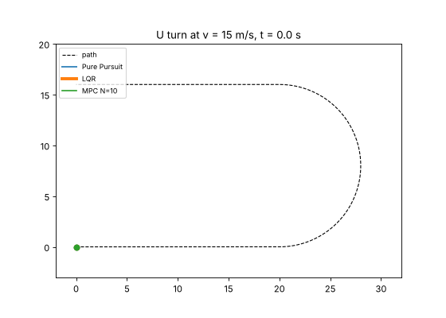
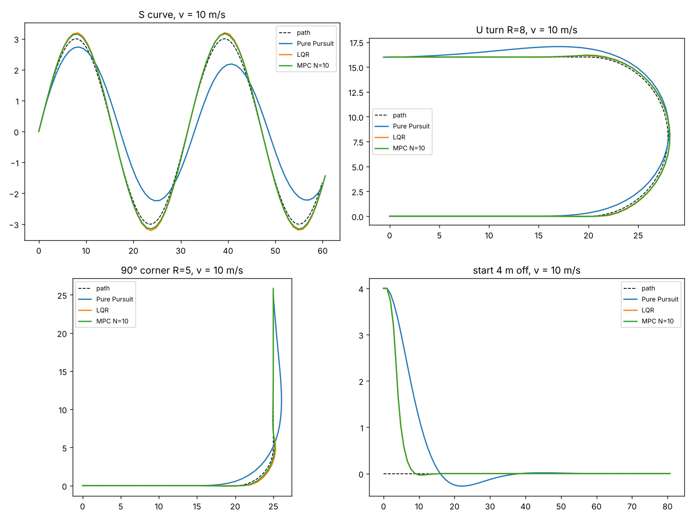
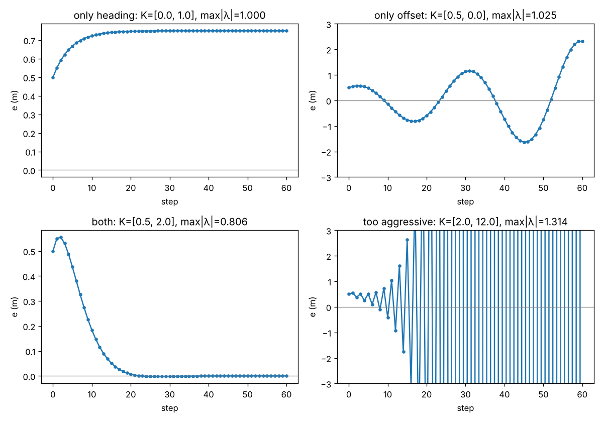
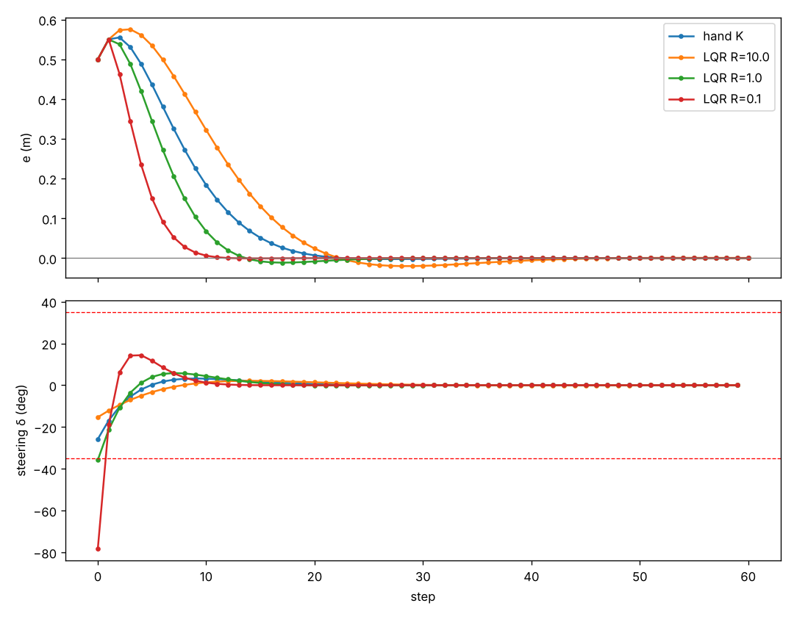
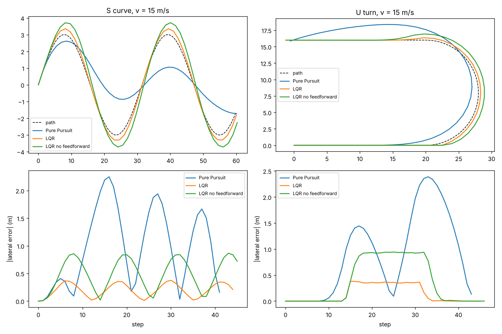
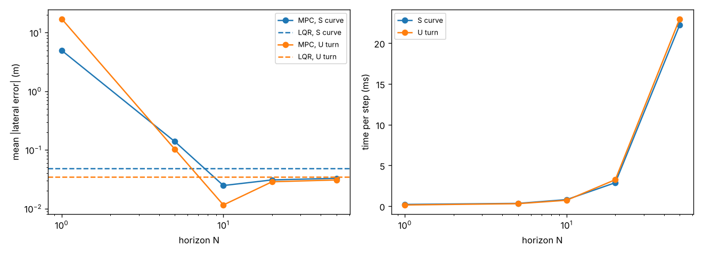
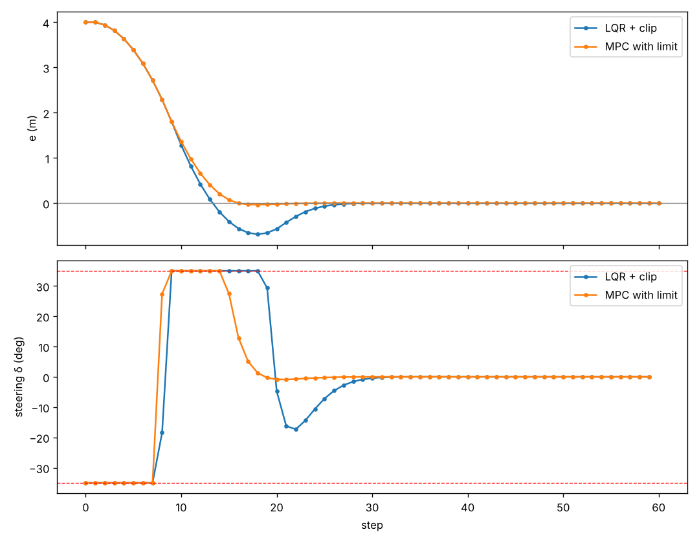

# Vehicle Lateral Control: LQR and MPC

[中文版](README_zh.md)



*Pure Pursuit, LQR and MPC on the same U-turn at 15 m/s. Pure Pursuit cuts the corner and swings wide on the exit, while LQR and MPC stay close to the path (their lines almost overlap).*

This project makes a car follow a path by steering. It continues my [2D planning and control project](https://github.com/asiansumer/2d-planning-control), where the car used Pure Pursuit, a geometric method with no model of the car. Here I write the car as a linear state-space model and use model-based controllers on it: state feedback, LQR and MPC. All of it is plain numpy, with no control or optimisation libraries, and every module has pytest tests (20 in total).

I took the Control M course (digital and continuous control) at the same time, so I tried to connect each level to an idea from the course: discrete state-space models, closed-loop poles inside the unit circle, the Riccati equation and receding-horizon control.

## How it works

```
path (x, y points) -> heading and curvature at every point
every 0.1 s:
  find the nearest path point
  -> lateral error e (m, left of path is positive) and heading error eθ (rad)
  -> controller picks the steering angle δ
       Pure Pursuit : steer towards a point Ld = max(2, 0.8 v) metres ahead
       LQR          : δ = feedforward atan(L κ) - K [e, eθ]
       MPC          : predict N steps with the path curvature ahead, minimise cost, apply the first δ
  -> clip δ to ±35°
  -> kinematic bicycle model moves the car one step (wheelbase L = 2.5 m)
```

The linear model that LQR and MPC use, with speed v and time step dt:

```
x = [e, eθ]                    x(k+1) = A x(k) + B δ(k)
A = [[1, v·dt],                B = [[0],
     [0, 1   ]]                     [v·dt / L]]
```

The first row says that if the car is pointing away from the path, it drifts sideways by v·dt·eθ every step. The second row says the steering wheel only changes the heading, never the position directly.

I built it in seven levels:

| Level | What I built | File |
|---|---|---|
| 1 | Linear error model A, B; the car drifts when it does not steer | `model.py`, `scripts/drift.py` |
| 2 | State feedback δ = −K x; stability from the eigenvalues of A − BK | `control.py`, `scripts/feedback.py` |
| 3 | LQR gain from the discrete Riccati iteration; effect of the weight R | `lqr.py`, `scripts/lqr_compare.py` |
| 4 | LQR on the bicycle model with curvature feedforward, against Pure Pursuit | `tracking.py`, `bicycle.py`, `scenarios.py`, `scripts/compare_tracking.py` |
| 5 | Unconstrained MPC with prediction matrices and curvature preview | `mpc.py`, `scripts/mpc_horizon.py` |
| 6 | MPC with a ±35° steering limit (projected gradient), against clipped LQR | `mpc.py`, `scripts/mpc_limits.py` |
| 7 | Four test scenarios at three speeds | `scripts/run_scenarios.py`, `scripts/make_gif.py` |

## Results

Mean absolute lateral error in metres. Q = I, R = 1 for LQR and MPC, MPC horizon N = 10, steering limited to ±35° for every method.

| Scenario | Speed | Pure Pursuit | LQR | MPC | MPC + limit |
|---|---:|---:|---:|---:|---:|
| S curve, y = 3 sin(x/5) | 5 m/s | 0.105 | 0.049 | **0.025** | **0.025** |
| | 10 m/s | 0.537 | 0.114 | **0.098** | **0.098** |
| | 15 m/s | 0.993 | 0.201 | **0.187** | **0.187** |
| U-turn, radius 8 m | 5 m/s | 0.068 | 0.035 | **0.012** | **0.012** |
| | 10 m/s | 0.329 | 0.084 | **0.075** | **0.075** |
| | 15 m/s | 0.909 | 0.142 | **0.137** | **0.137** |
| 90° corner, radius 5 m | 5 m/s | 0.078 | 0.025 | **0.013** | **0.013** |
| | 10 m/s | 0.394 | 0.061 | **0.043** | **0.043** |
| | 15 m/s | 0.771 | 0.131 | **0.110** | **0.110** |
| Start 4 m off a straight line | 10 m/s | 0.425 | **0.209** | **0.209** | **0.209** |



LQR and MPC are about 2 to 9 times more accurate than Pure Pursuit, and the gap in metres grows with speed. MPC is a little better than LQR on curves because it sees the curvature of the next 10 steps. The steering does reach 35° in the 90° corner at 10 and 15 m/s and when starting 4 m off, but only briefly, so MPC with the limit inside the optimisation gives the same result as MPC whose command is clipped afterwards. Finding 6 shows when the limit does matter.

## Findings

### Finding 1: steering only on one of the two errors is not enough



With δ = −K x, the car follows x(k+1) = (A − BK) x(k), so the eigenvalues λ of A − BK decide everything. Start: 0.5 m off the path, heading 0.1 rad off, v = 5 m/s.

| K = [k_e, k_θ] | Largest abs(λ) | What happens |
|---|---:|---|
| [0, 1], heading only | 1.000 | e stops growing but stays at 0.75 m |
| [0.5, 0], offset only | 1.025 | weaving that grows every swing |
| [0.5, 2], both | 0.806 | back on the path in about 20 steps |
| [2, 12], too aggressive | 1.314 | violent oscillation that blows up |

These are the poles inside / on / outside the unit circle from the course. "Offset only" was the surprising one: correcting only the distance makes the car overshoot again and again, because nothing damps the heading.

### Finding 2: R trades speed against steering effort



LQR minimises the sum of xᵀQx + δᵀRδ. With Q = I and the car starting 0.5 m off:

| | K | Steps until e < 0.05 m | Largest steering |
|---|---|---:|---:|
| Hand-tuned K | [0.5, 2.0] | 16 | 25.8° |
| LQR, R = 10 | [0.28, 1.28] | 19 | 15.3° |
| LQR, R = 1 | [0.78, 2.33] | 11 | 35.8° |
| LQR, R = 0.1 | [1.91, 4.14] | 8 | **78.3°** |

R = 0.1 is fastest but asks for 78° of steering on the first step, which a real car cannot do. LQR has no idea that the steering wheel has a limit. That is the reason for level 6.

### Finding 3: without feedforward, feedback leaves a steady error on curves



On a curve the car needs a steering angle of atan(L κ) even when e = eθ = 0, but −K x is zero there. So pure feedback can only steer if the car is already off the path, and it settles at an offset where −K x is just enough. On the U-turn arc this offset is about 0.9 m at 15 m/s (the flat green line in the bottom-right plot). It is the same steady-state error as a P-only speed controller in my 2D project. Adding the feedforward term atan(L κ) cuts the mean error from 0.37 m to 0.14 m on the U-turn and from 0.48 m to 0.20 m on the S curve at 15 m/s.

### Finding 4: Pure Pursuit gets worse with speed

Pure Pursuit looks Ld = max(2, 0.8 v) metres ahead, the setting from my 2D project. At 15 m/s that is 12 m, so it aims at a point far around the corner and cuts inside (blue line in the GIF). On the S curve its mean error grows from 0.11 m at 5 m/s to 0.99 m at 15 m/s. In fairness, I did not retune Ld for high speed, and a shorter look-ahead would close part of the gap.

### Finding 5: MPC with a long horizon is LQR



Without constraints, MPC solves the same problem as LQR but only over N steps. With N = 50 its first steering command is −0.6243, identical to LQR's −K x (this is a test in `tests/test_mpc.py`). The horizon matters in both directions:

| v = 5 m/s | S curve error | U-turn error | Time per step |
|---|---:|---:|---:|
| LQR | 0.048 | 0.035 | about 0.1 ms |
| MPC N = 1 | 4.97 (leaves the path) | 17.2 (leaves the path) | 0.2 ms |
| MPC N = 5 | 0.139 | 0.103 | 0.3 ms |
| MPC N = 10 | **0.025** | **0.011** | 0.8 ms |
| MPC N = 50 | 0.033 | 0.031 | 22 ms |

N = 1 fails because a steering command does not change e until the second step (the first row of B is 0). Looking only one step ahead, MPC thinks steering is useless and barely steers. N = 10 was both the most accurate and fast enough. N = 20 and 50 are slightly worse, probably because I use no terminal cost, and they are much slower.

### Finding 6: a steering limit matters when the controller is aggressive



The simple way to respect ±35° is to compute the LQR command and clip it. MPC can instead include the limit in the optimisation, which I solve with projected gradient descent (take a gradient step, then clip every δ back into ±35°). Starting 4 m off the path with an aggressive R = 0.1 at 5 m/s, on the linear model:

| | Overshoot | Steps until e < 0.05 m | Total cost |
|---|---:|---:|---:|
| LQR, then clip | 0.69 m | 26 | 108.9 |
| MPC with the limit | **0.03 m** | **16** | **105.5** |

MPC starts to straighten the wheel about 4 steps earlier, because it knows that unwinding a full lock takes time. Clipped LQR stays at full lock too long and overshoots. On the bicycle model the result is the same (overshoot 0.196 m against 0.001 m). With the normal R = 1, or at 10 m/s, the difference disappears, because the commands rarely hit the limit.

### Finding 7: the remaining error at high speed comes from the time step

With feedforward, LQR still has 0.38 m maximum error on the U-turn at 15 m/s. At that speed the car moves 1.5 m between two control updates with a fixed steering angle. With dt = 0.02 s instead of 0.1 s, the maximum error drops to 0.06 m.

## How to run

Python 3.10 with numpy, matplotlib and pytest (`requirements.txt`). From the repo root:

```bash
python -m pytest -q                  # 20 tests
python -m scripts.drift              # level 1
python -m scripts.feedback           # level 2
python -m scripts.lqr_compare        # level 3
python -m scripts.compare_tracking   # level 4
python -m scripts.mpc_horizon        # level 5
python -m scripts.mpc_limits         # level 6
python -m scripts.run_scenarios      # level 7: results table and results/scenarios.png
python -m scripts.make_gif           # results/uturn.gif
```

## Project structure

```
model.py       linear lateral error model A, B
control.py     state feedback, closed-loop matrix A - BK, simulation on the linear model
lqr.py         LQR gain from the discrete Riccati iteration
mpc.py         prediction matrices, unconstrained MPC, MPC with a steering limit
bicycle.py     kinematic bicycle model, one step
tracking.py    path heading/curvature, tracking errors, Pure Pursuit / LQR / MPC steering, closed loop
scenarios.py   S curve, U-turn, 90° corner, straight line
scripts/       one script per level
tests/         pytest tests
results/       the figures in this README
```

## Limitations and next steps

- **Kinematic model only.** There are no tyres, no slip and no lateral dynamics. A U-turn of radius 8 m at 15 m/s needs about 2.9 g of lateral acceleration, which no real car can do. A dynamic bicycle model with tyre cornering stiffness is the next step, and it is where LQR and MPC should really pull ahead of Pure Pursuit.
- **Constant speed.** Only steering is controlled. Speed control (or slowing down by curvature, which was also missing in my 2D project) is not included.
- **Pure Pursuit was not retuned** for high speed (Finding 4).
- **Simple MPC.** No terminal cost, only a limit on the steering angle (not on its rate), and a basic projected gradient solver. A real system would use a QP solver such as OSQP and also limit how fast the wheel can turn.
- **Small-angle linearisation.** The model uses tan δ ≈ δ and small heading errors. It worked here, but large errors (like the 4 m start) are at the edge of where it is valid.
- **Python speed.** MPC with N = 50 takes 22 ms per step in numpy. The prediction matrices are rebuilt every step and could be cached, or the controller could be rewritten in C++.
