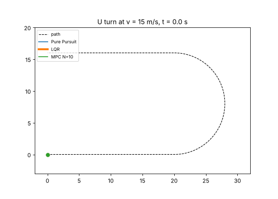
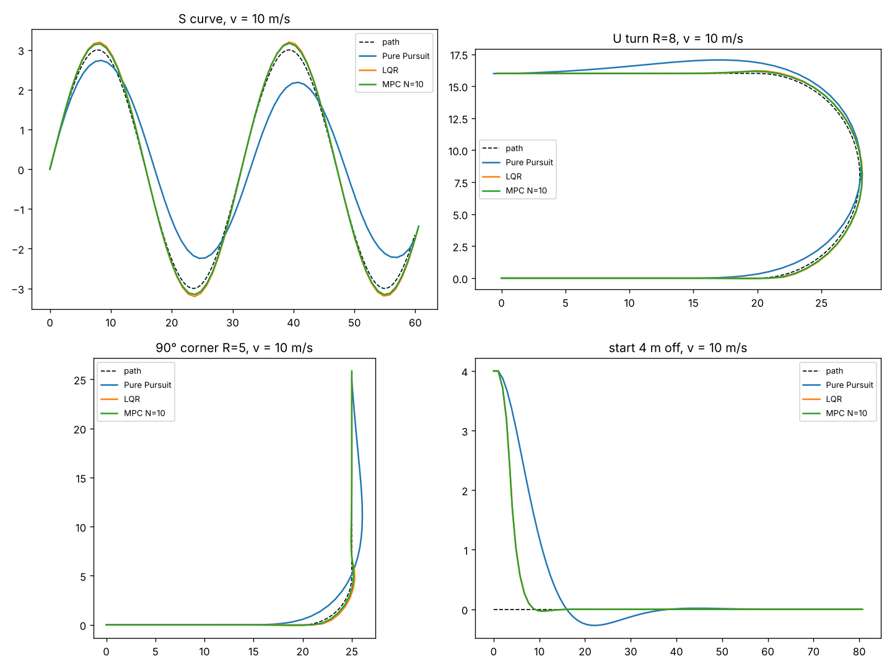
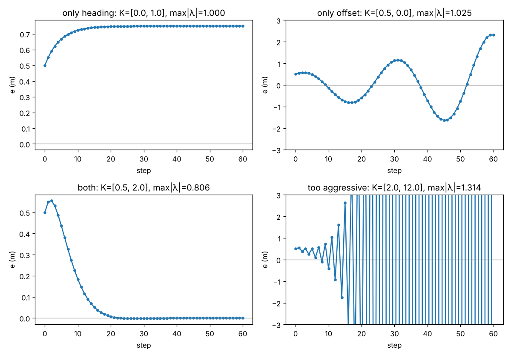
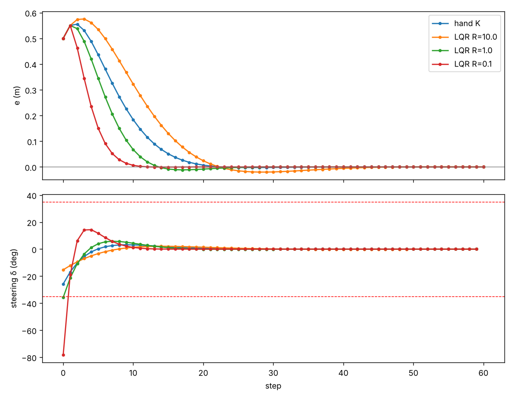
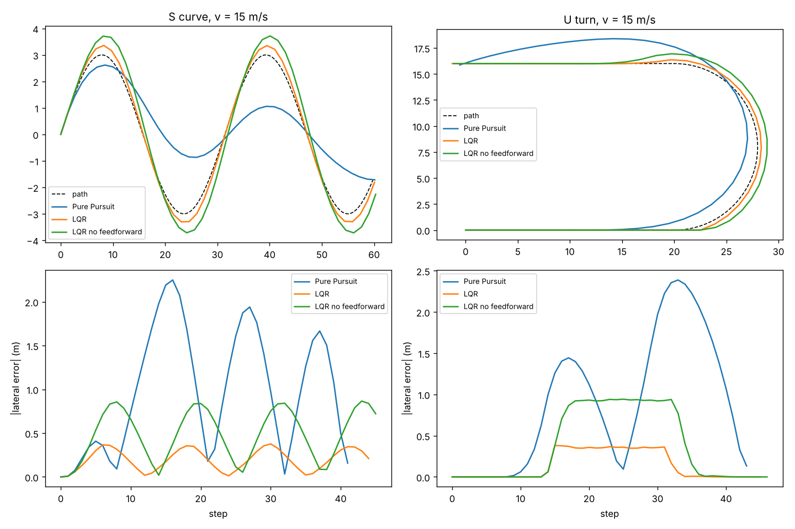
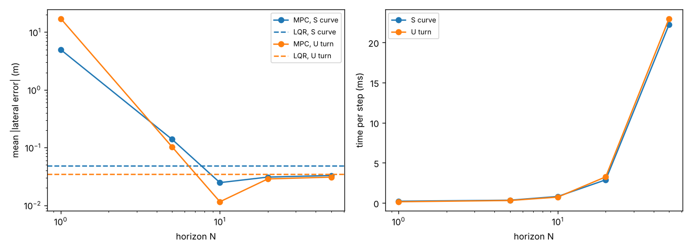
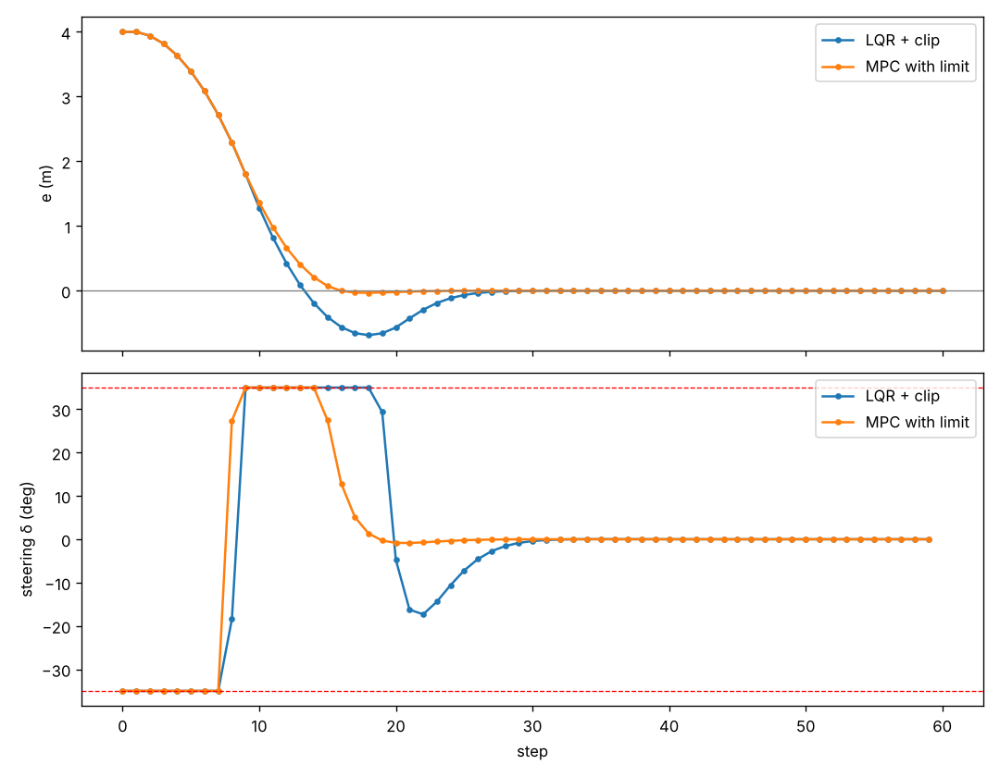

# 车辆横向控制：LQR 和 MPC

[English](README.md)



*Pure Pursuit、LQR 和 MPC 以 15 m/s 过同一个 U 弯。Pure Pursuit 在弯里抄近路、出弯又甩出去；LQR 和 MPC 一直贴着路线（两条线几乎重合）。*

这个项目让车通过打方向盘沿一条路线开。它接着我的 [二维规划与控制项目](https://github.com/asiansumer/2d-planning-control)：那个项目里车用的是 Pure Pursuit，一种不需要车辆模型的几何方法。这次我把车写成线性状态空间模型，在它上面用基于模型的控制器：状态反馈、LQR 和 MPC。全部只用 numpy，没用任何控制或优化库，每个模块都有 pytest 测试（共 20 个）。

做这个项目时我正在上 Control M 课（数字控制和连续控制），所以每一关都尽量对上课上的一个概念：离散状态空间模型、闭环极点在单位圆内、Riccati 方程、滚动时域控制。

## 怎么工作

```
路线（一串 x, y 点）-> 算出每个点的朝向和曲率
每 0.1 秒：
  找路线上离车最近的点
  -> 横向误差 e（米，在路线左边为正）和航向误差 eθ（弧度）
  -> 控制器决定方向盘角 δ
       Pure Pursuit：朝前方 Ld = max(2, 0.8 v) 米处的点打方向盘
       LQR         ：δ = 前馈 atan(L κ) − K [e, eθ]
       MPC         ：结合前方路线的曲率预测 N 步，找罚款最小的打法，只执行第一步
  -> 方向盘限制在 ±35°
  -> 运动学自行车模型走一步（轴距 L = 2.5 米）
```

LQR 和 MPC 用的线性模型（车速 v，步长 dt）：

```
x = [e, eθ]                    x(k+1) = A x(k) + B δ(k)
A = [[1, v·dt],                B = [[0],
     [0, 1   ]]                     [v·dt / L]]
```

第一行的意思是：车头歪着往前开，每一步就会往侧面多偏 v·dt·eθ。第二行的意思是：方向盘只能改变车头方向，不能直接让车平移。

一共 7 关：

| 关 | 做了什么 | 文件 |
|---|---|---|
| 1 | 线性误差模型 A、B；不打方向盘车就会越偏越远 | `model.py`、`scripts/drift.py` |
| 2 | 状态反馈 δ = −K x；用 A − BK 的特征值判断稳定 | `control.py`、`scripts/feedback.py` |
| 3 | 离散 Riccati 迭代求 LQR 增益；权重 R 的影响 | `lqr.py`、`scripts/lqr_compare.py` |
| 4 | LQR 加曲率前馈，放到自行车模型上和 Pure Pursuit 比 | `tracking.py`、`bicycle.py`、`scenarios.py`、`scripts/compare_tracking.py` |
| 5 | 无约束 MPC：预测矩阵 + 前方曲率预瞄 | `mpc.py`、`scripts/mpc_horizon.py` |
| 6 | 带 ±35° 方向盘限制的 MPC（投影梯度），和“LQR 算完再截断”比 | `mpc.py`、`scripts/mpc_limits.py` |
| 7 | 四个场景、三种车速的对比 | `scripts/run_scenarios.py`、`scripts/make_gif.py` |

## 结果

平均横向误差（米）。LQR 和 MPC 都用 Q = I、R = 1，MPC 预测 N = 10 步，所有方法的方向盘都限制在 ±35°。

| 场景 | 车速 | Pure Pursuit | LQR | MPC | MPC + 限制 |
|---|---:|---:|---:|---:|---:|
| S 弯，y = 3 sin(x/5) | 5 m/s | 0.105 | 0.049 | **0.025** | **0.025** |
| | 10 m/s | 0.537 | 0.114 | **0.098** | **0.098** |
| | 15 m/s | 0.993 | 0.201 | **0.187** | **0.187** |
| U 弯，半径 8 米 | 5 m/s | 0.068 | 0.035 | **0.012** | **0.012** |
| | 10 m/s | 0.329 | 0.084 | **0.075** | **0.075** |
| | 15 m/s | 0.909 | 0.142 | **0.137** | **0.137** |
| 90° 弯，半径 5 米 | 5 m/s | 0.078 | 0.025 | **0.013** | **0.013** |
| | 10 m/s | 0.394 | 0.061 | **0.043** | **0.043** |
| | 15 m/s | 0.771 | 0.131 | **0.110** | **0.110** |
| 直线，一开始偏 4 米 | 10 m/s | 0.425 | **0.209** | **0.209** | **0.209** |



LQR 和 MPC 的误差大约只有 Pure Pursuit 的 1/2 到 1/9，车速越快，差的米数越多。在弯道上 MPC 比 LQR 略好一点，因为它能看到后面 10 步路线的曲率。在 10 和 15 m/s 的 90° 弯、以及一开始偏 4 米时，方向盘确实会打到 35°，但只是很短的时间，所以“把限制放进优化里”的 MPC 和“算完再截断”的 MPC 结果一样。发现 6 讲限制在什么时候才真正起作用。

## 发现

### 发现 1：只纠正一个误差不够



用 δ = −K x，车就按 x(k+1) = (A − BK) x(k) 走，所以一切都由 A − BK 的特征值 λ 决定。起点：离路线 0.5 米，车头歪 0.1 弧度，v = 5 m/s。

| K = [k_e, k_θ] | 最大的 abs(λ) | 结果 |
|---|---:|---|
| [0, 1]，只管车头 | 1.000 | e 不再变大，但一直停在 0.75 米 |
| [0.5, 0]，只管距离 | 1.025 | 蛇行，而且越摆越大 |
| [0.5, 2]，两个都管 | 0.806 | 大约 20 步回到路线上 |
| [2, 12]，太猛 | 1.314 | 剧烈来回抖，最后发散 |

这正是课上讲的极点在单位圆内 / 上 / 外。“只管距离”最出乎我意料：只纠正距离会让车一次次冲过头，因为没有东西去抑制车头的摆动。

### 发现 2：R 在“回得快”和“打得猛”之间取舍



LQR 最小化 xᵀQx + δᵀRδ 的总和。Q = I，车一开始离路线 0.5 米：

| | K | e < 0.05 米用的步数 | 最大方向盘 |
|---|---|---:|---:|
| 手调 K | [0.5, 2.0] | 16 | 25.8° |
| LQR，R = 10 | [0.28, 1.28] | 19 | 15.3° |
| LQR，R = 1 | [0.78, 2.33] | 11 | 35.8° |
| LQR，R = 0.1 | [1.91, 4.14] | 8 | **78.3°** |

R = 0.1 回得最快，但第一步就要求打 78°，真车做不到。LQR 根本不知道方向盘有极限，这就是第 6 关要解决的问题。

### 发现 3：没有前馈，弯道上会一直偏着



在弯道上，就算 e = eθ = 0，车也需要打 atan(L κ) 的方向盘，可这时 −K x 等于 0。所以只靠反馈的话，车必须先偏出去才会打方向盘，最后停在一个刚好让 −K x 够用的偏差上。15 m/s 时，这个偏差在 U 弯半圆段上大约是 0.9 米（右下图那条平的绿线）。这和我二维项目里“只用 P 控制车速会有稳态误差”是同一件事。加上前馈 atan(L κ) 之后，15 m/s 时 U 弯的平均误差从 0.37 米降到 0.14 米，S 弯从 0.48 米降到 0.20 米。

### 发现 4：Pure Pursuit 车速越快越差

Pure Pursuit 往前看 Ld = max(2, 0.8 v) 米，这是二维项目里的设置。15 m/s 时就是 12 米，它瞄向弯道很远处的点，于是往里切（动图里的蓝线）。S 弯上它的平均误差从 5 m/s 的 0.11 米涨到 15 m/s 的 0.99 米。公平地说，我没有为高速重新调 Ld，预瞄距离短一些能缩小一部分差距。

### 发现 5：预测得足够远的 MPC 就是 LQR



没有约束时，MPC 解的和 LQR 是同一个问题，只是只看 N 步。N = 50 时它第一步的方向盘是 −0.6243，和 LQR 的 −K x 完全一样（`tests/test_mpc.py` 里有这个测试）。N 太小、太大都不好：

| v = 5 m/s | S 弯误差 | U 弯误差 | 每步计算时间 |
|---|---:|---:|---:|
| LQR | 0.048 | 0.035 | 约 0.1 ms |
| MPC N = 1 | 4.97（跑出路线） | 17.2（跑出路线） | 0.2 ms |
| MPC N = 5 | 0.139 | 0.103 | 0.3 ms |
| MPC N = 10 | **0.025** | **0.011** | 0.8 ms |
| MPC N = 50 | 0.033 | 0.031 | 22 ms |

N = 1 会失败，因为方向盘打下去，要到第二步 e 才开始变（B 的第一行是 0）。只看一步的话，MPC 觉得打方向盘没用，几乎不打。N = 10 又准又快。N = 20、50 反而略差，可能是因为我没加终点罚款，而且慢很多。

### 发现 6：控制器调得很猛时，方向盘限制才重要



满足 ±35° 最简单的办法是 LQR 算完再截断。MPC 则可以把限制直接放进优化里，我用投影梯度下降来解（往梯度方向走一步，再把每个 δ 截回 ±35° 以内，反复做）。在线性模型上，车从路线 4 米外出发，R = 0.1（很猛），v = 5 m/s：

| | 冲过头 | e < 0.05 米用的步数 | 总罚款 |
|---|---:|---:|---:|
| LQR 算完再截断 | 0.69 米 | 26 | 108.9 |
| 带限制的 MPC | **0.03 米** | **16** | **105.5** |

MPC 大约早 4 步开始回正，因为它知道方向盘从打满到回正需要时间。截断后的 LQR 打满打太久，于是冲过了头。在自行车模型上结果一样（冲过头 0.196 米对 0.001 米）。换成正常的 R = 1，或者车速到 10 m/s，差别就没了，因为方向盘很少碰到极限。

### 发现 7：高速时剩下的误差来自步长

加了前馈，LQR 在 15 m/s 的 U 弯上最大误差还有 0.38 米。这个速度下，两次控制之间车要开 1.5 米，方向盘一直不变。把 dt 从 0.1 秒改成 0.02 秒，最大误差降到 0.06 米。

## 怎么运行

Python 3.10，需要 numpy、matplotlib 和 pytest（见 `requirements.txt`）。在仓库根目录运行：

```bash
python -m pytest -q                  # 20 个测试
python -m scripts.drift              # 第 1 关
python -m scripts.feedback           # 第 2 关
python -m scripts.lqr_compare        # 第 3 关
python -m scripts.compare_tracking   # 第 4 关
python -m scripts.mpc_horizon        # 第 5 关
python -m scripts.mpc_limits         # 第 6 关
python -m scripts.run_scenarios      # 第 7 关：结果表和 results/scenarios.png
python -m scripts.make_gif           # results/uturn.gif
```

## 项目结构

```
model.py       线性横向误差模型 A、B
control.py     状态反馈、闭环矩阵 A - BK、在线性模型上仿真
lqr.py         离散 Riccati 迭代求 LQR 增益
mpc.py         预测矩阵、无约束 MPC、带方向盘限制的 MPC
bicycle.py     运动学自行车模型走一步
tracking.py    路线朝向/曲率、跟踪误差、Pure Pursuit / LQR / MPC 转向、闭环仿真
scenarios.py   S 弯、U 弯、90° 弯、直线
scripts/       每关一个脚本
tests/         pytest 测试
results/       README 里的图
```

## 局限和下一步

- **只有运动学模型。** 没有轮胎、没有侧滑、没有横向动力学。15 m/s 过半径 8 米的 U 弯需要约 2.9 g 的横向加速度，真车做不到。下一步是带轮胎侧偏刚度的动力学自行车模型，那时 LQR 和 MPC 相对 Pure Pursuit 的优势应该更明显。
- **车速不变。** 只控制方向盘，没有速度控制（二维项目里缺的“按曲率限速”这里也没做）。
- **Pure Pursuit 没有为高速重新调参**（见发现 4）。
- **MPC 比较简单。** 没有终点罚款；只限制方向盘角度，没限制转动速度；求解器是最基础的投影梯度。实际系统会用 OSQP 这类 QP 求解器，还会限制方向盘转得多快。
- **小角度线性化。** 模型用了 tan δ ≈ δ，并假设航向误差很小。这里够用，但像一开始偏 4 米这种大误差，已经在它适用范围的边上了。
- **Python 速度。** N = 50 的 MPC 用 numpy 每步要 22 ms。预测矩阵每步都重新算，可以缓存起来，或者用 C++ 重写控制器。
